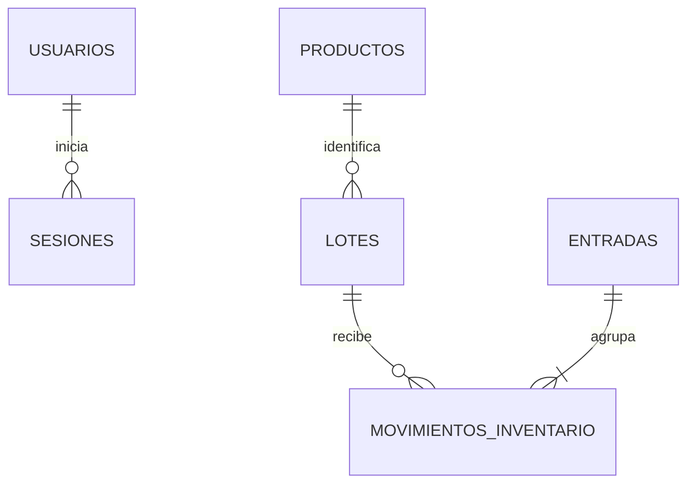

# Arquitectura y modelo

Monolito por capas, con contratos REST y módulos de dominio separados por responsabilidades. Conserva los nombres y el recorrido de pharmaSoft (`controller`, `dto`, `entity`, `mapper`, `repository`, `service/service`, `service/impl`, `config`, `security`, `exception`, `util`, `enums`). Las entidades no se serializan como respuestas REST.

## Diccionario resumido

| Tabla | Campos y restricciones principales |
|---|---|
| usuarios | id bigint PK, username varchar(60) único, password_hash varchar(100), nombre_completo varchar(150), rol varchar(30), activo boolean |
| sesiones | id UUID representado en varchar(36) PK, usuario_id FK, expira_en timestamp con zona, revocada boolean |
| productos | id PK, codigo varchar(50) único, nombre varchar(150), presentacion varchar(100), precio_venta decimal(12,2)>0, stock_minimo bigint≥0, activo, creado_en, creado_por, version |
| lotes | id PK, producto_id FK, codigo varchar(80), fecha_vencimiento date, cantidad_disponible bigint≥0, creado_en, version; único producto/código |
| entradas | id PK, clave_idempotencia UUID textual único, huella SHA-256 del cuerpo normalizado y usuario, referencia, observacion, creado_en, creado_por |
| movimientos_inventario | id PK, entrada_id FK, lote_id FK, tipo ENTRADA, cantidad>0; único entrada/lote |

SQL completo y tipos: `src/main/resources/db/migration/V1__base_sprint_1.sql`. Fechas de auditoría en UTC; fecha de negocio según America/Lima. Dinero con BigDecimal y NUMERIC, nunca double.

## Consistencia

`EntradaServiceImpl` ejecuta guardado de entrada, lotes y movimientos en una sola transacción. Bloquea los productos involucrados con `PESSIMISTIC_WRITE` en orden ascendente y vuelve a consultar la clave idempotente después del bloqueo. Los índices únicos resuelven además carreras entre solicitudes con distintas listas de productos. La recuperación de una colisión única ocurre fuera de la transacción fallida.

`Lote.cantidadDisponible` es el saldo operativo; los movimientos conservan su origen. El stock de producto se agrega desde lotes, sin copiarse a otra columna. La consulta de stock utiliza una agregación por página, no una consulta por cada producto. Páginas de máximo 100; carga de asociaciones por lotes de Hibernate.

Las consultas de stock usan `REPEATABLE_READ` para que físico y vendible correspondan al mismo estado. Nuevos escritores de inventario deben respetar el mismo orden de bloqueos y transacciones.

## Extensión por sprint

1. Ventas: incorporar Venta/DetalleVenta y selección de lotes (por ejemplo FEFO, previa aprobación). Extender movimientos para salidas; descontar saldo en la misma transacción con los mismos bloqueos, validando vigencia y stock. No permitir actualización directa de cantidades desde un CRUD.
2. Anulaciones: movimientos compensatorios, motivo, responsable e idempotencia; conservar el registro original.
3. Bajas y ajustes: nuevos tipos de movimiento y permisos específicos. Migrar `entrada_id` para admitir referencias a otros documentos sin perder la trazabilidad.
4. Reportes: proyecciones SQL y consultas de solo lectura; separar consultas costosas cuando el volumen lo requiera.
5. Usuarios: ampliar el catálogo de roles/permisos y CRUD administrativo. Hoy los permisos se resuelven en `PermisosPorRol`; la sesión consulta el estado/rol actual en BD, sin confiar solamente en lo firmado en un JWT antiguo.
6. Escalado horizontal: PostgreSQL compartido, secreto JWT común y variables externas por entorno. Las sesiones y la idempotencia están en BD, no en memoria local. H2 no es la opción para varias instancias. Añadir limpieza programada de sesiones expiradas y métricas operativas según carga.

No se agrega una arquitectura de microservicios antes de que existan necesidades de despliegue independiente. Para producción faltan los controles operativos del entorno: HTTPS, política de respaldo, límites de intentos en el ingreso, monitorización y validación de carga y de PostgreSQL.
